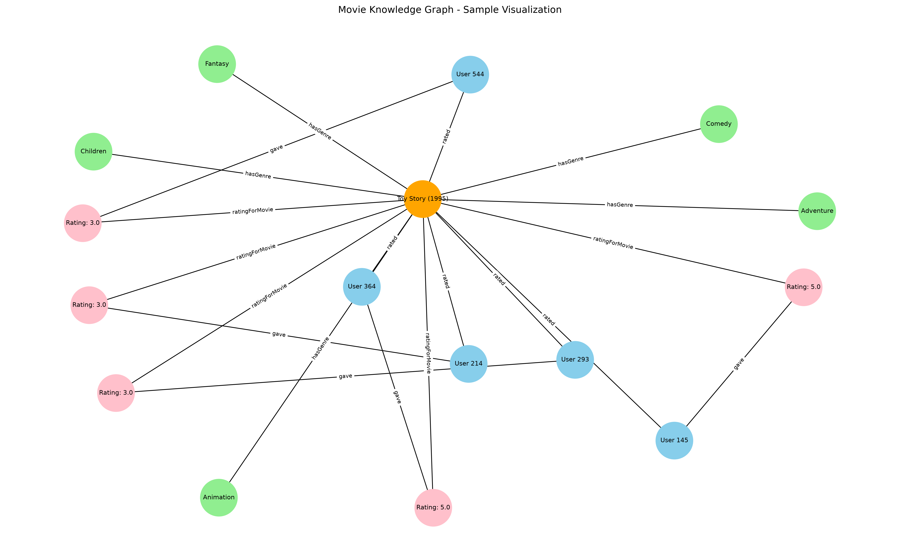

# Movie Knowledge Graph

A Knowledge Based Systems (KBS) project that transforms MovieLens datasets into an RDF/OWL-based Movie Knowledge Graph using Python and RDFLib.

The knowledge graph connects movies, users, genres, ratings, and tags through meaningful relationships. It supports SPARQL queries and graph visualization.

## 1. Project Overview

Movie-related information is stored in separate datasets, making it difficult to explore relationships between movies, users, genres, ratings, and tags.

This project integrates these datasets into a single Knowledge Graph using Semantic Web technologies.

The graph represents information as RDF triples (Subject, Predicate, Object), allowing connected data to be queried using SPARQL.

## 2. What We Built

We developed a complete Movie Knowledge Graph pipeline with the following components:

- **Ontology Creation:** Defined the knowledge structure using OWL classes and properties.
- **Knowledge Graph Construction:** Converted MovieLens CSV datasets into RDF triples.
- **Entity Relationships:** Connected movies, users, genres, ratings, and tags.
- **SPARQL Queries:** Retrieved information from the knowledge graph.
- **Graph Visualization:** Generated a visual representation of a sample movie and its connections.

## 3. Dataset

We used the MovieLens dataset, which contains movie information, user ratings, tags, and external movie identifiers.

| Dataset | Description | Records |
|---|---|---:|
| `movies.csv` | Movie IDs, titles, and genres | 9,742 |
| `ratings.csv` | User ratings and timestamps | 100,836 |
| `tags.csv` | User-generated movie tags | 3,683 |
| `links.csv` | IMDb and TMDb identifiers | 9,742 |

**Total users:** 610

**Total genres:** 19

## 4. Knowledge Graph Statistics

The generated knowledge graph contains:

| Component | Total |
|---|---:|
| RDF Triples | 702,873 |
| Movies | 9,742 |
| Users | 610 |
| Ratings | 100,836 |
| Tags | 3,683 |
| Genres | 19 |

These statistics represent the successfully generated knowledge graph.

## 5. Ontology Design

We created an OWL ontology using RDFLib.

### OWL Classes

The ontology defines five main classes:

| Class | Description |
|---|---|
| `Movie` | Represents movies |
| `User` | Represents users |
| `Genre` | Represents movie genres |
| `Rating` | Represents individual ratings |
| `Tag` | Represents user-generated tags |

### Object Properties

Object properties define relationships between entities.

| Property | Domain | Range |
|---|---|---|
| `rated` | User | Movie |
| `hasGenre` | Movie | Genre |
| `addedTag` | User | Tag |
| `hasTag` | Movie | Tag |
| `ratedBy` | Rating | User |
| `ratingForMovie` | Rating | Movie |
| `taggedBy` | Tag | User |
| `tagForMovie` | Tag | Movie |

### Datatype Properties

Datatype properties store literal values such as:

- `movieId`
- `movieTitle`
- `userId`
- `genreName`
- `tagName`
- `ratingValue`
- `timestamp`
- `tagTimestamp`
- `imdbId`
- `tmdbId`

## 6. SPARQL Queries

We implemented and successfully executed four SPARQL queries.

| Query | Purpose |
|---|---|
| Query 1 | Retrieve the first 10 movies |
| Query 2 | Retrieve all available genres |
| Query 3 | Retrieve user ratings for Toy Story |
| Query 4 | Retrieve movies with their genres |

These queries demonstrate how information can be retrieved from the knowledge graph through semantic relationships.

## 7. Graph Visualization

We used NetworkX and Matplotlib to visualize a sample of the Movie Knowledge Graph.

The visualization demonstrates how a movie connects with its genres, users, and ratings.

**Note:** The PNG visualization represents a sample of the graph, not all 702,873 RDF triples. This keeps the visualization readable.



## 8. Project Structure

```text
movie-knowledge-graph/
│
├── data/
│   ├── movies.csv
│   ├── ratings.csv
│   ├── tags.csv
│   └── links.csv
│
├── src/
│   ├── ontology.py
│   ├── build_graph.py
│   ├── queries.py
│   └── visualize.py
│
├── output/
│   ├── movie_ontology.owl
│   ├── movie_knowledge_graph.ttl
│   └── movie_knowledge_graph.png
│
├── check_data.py
├── requirements.txt
├── README.md
├── RATIONALE.md
└── .gitignore
```

### File Descriptions

| File / Folder | Purpose |
|---|---|
| `data/` | Contains the original MovieLens CSV datasets |
| `ontology.py` | Creates the OWL ontology |
| `build_graph.py` | Builds the RDF knowledge graph |
| `queries.py` | Executes SPARQL queries |
| `visualize.py` | Generates graph visualization |
| `check_data.py` | Checks CSV files and their records |
| `output/` | Stores generated ontology, graph, and visualization |
| `requirements.txt` | Contains required Python libraries |
| `RATIONALE.md` | Explains the technical decisions behind the project |

## 9. Installation and Execution

### Step 1: Clone the Repository

```bash
git clone https://github.com/YasirNazir176/movie-knowledge-graph.git

cd movie-knowledge-graph
```

### Step 2: Install Dependencies

```bash
pip install -r requirements.txt
```

### Step 3: Check Dataset Files

```bash
python check_data.py
```

### Step 4: Create the Ontology

```bash
python src/ontology.py
```

This creates:

```text
output/movie_ontology.owl
```

### Step 5: Build the Knowledge Graph

```bash
python src/build_graph.py
```

This process loads the ontology and CSV datasets, creates RDF entities and relationships, and generates:

```text
output/movie_knowledge_graph.ttl
```

### Step 6: Execute SPARQL Queries

```bash
python src/queries.py
```

This executes the four implemented SPARQL queries.

### Step 7: Generate Graph Visualization

```bash
python src/visualize.py
```

This generates:

```text
output/movie_knowledge_graph.png
```

**Important:** Run the scripts in the above order because each step depends on the outputs of previous steps.

## 10. Technologies Used

| Technology | Purpose |
|---|---|
| Python | Main programming language |
| Pandas | CSV data processing |
| RDFLib | RDF graph and ontology creation |
| OWL | Ontology representation |
| SPARQL | Knowledge graph querying |
| NetworkX | Graph structure and visualization |
| Matplotlib | Graph visualization |

## 11. Generated Outputs

After successful execution, the `output/` directory contains:

| Output File | Description |
|---|---|
| `movie_ontology.owl` | OWL ontology containing classes and properties |
| `movie_knowledge_graph.ttl` | Complete RDF knowledge graph in Turtle format |
| `movie_knowledge_graph.png` | Sample graph visualization |

## 12. Dataset Source

MovieLens Dataset:

https://grouplens.org/datasets/movielens/

The project uses the MovieLens CSV files: `movies.csv`, `ratings.csv`, `tags.csv`, and `links.csv`.

## 13. Team Members

| Name | Roll Number |
|---|---:|
| Yasir Nazir | 11 |
| Ruhma Shahid | 12 |
| Ahsan Jalil | 40 |

## 14. Course Information

**Course:** Knowledge Based Systems (KBS)

**Instructor:** Muhammad Ishaq

**Department:** Artificial Intelligence

**Project Type:** Academic Assignment